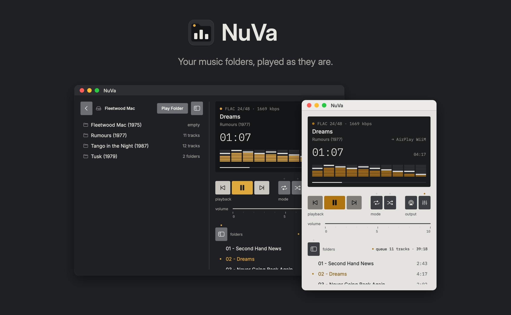
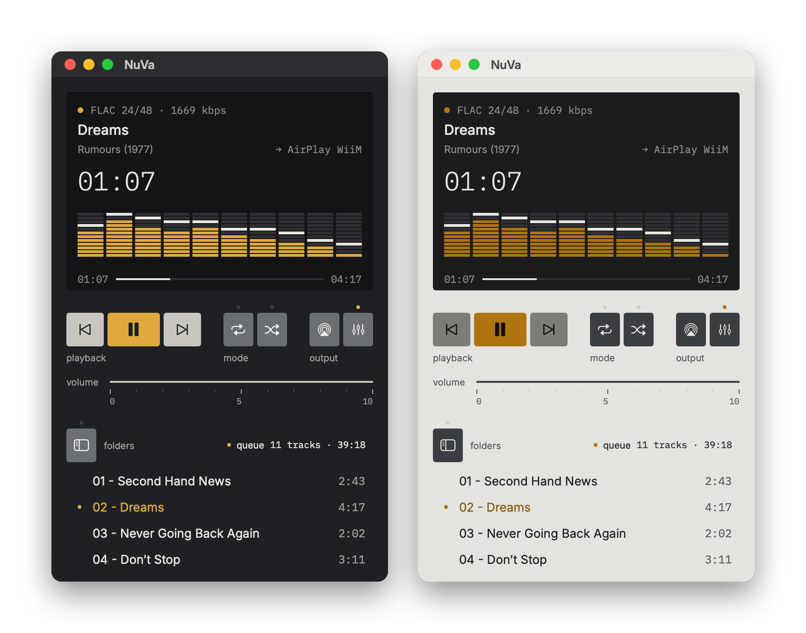
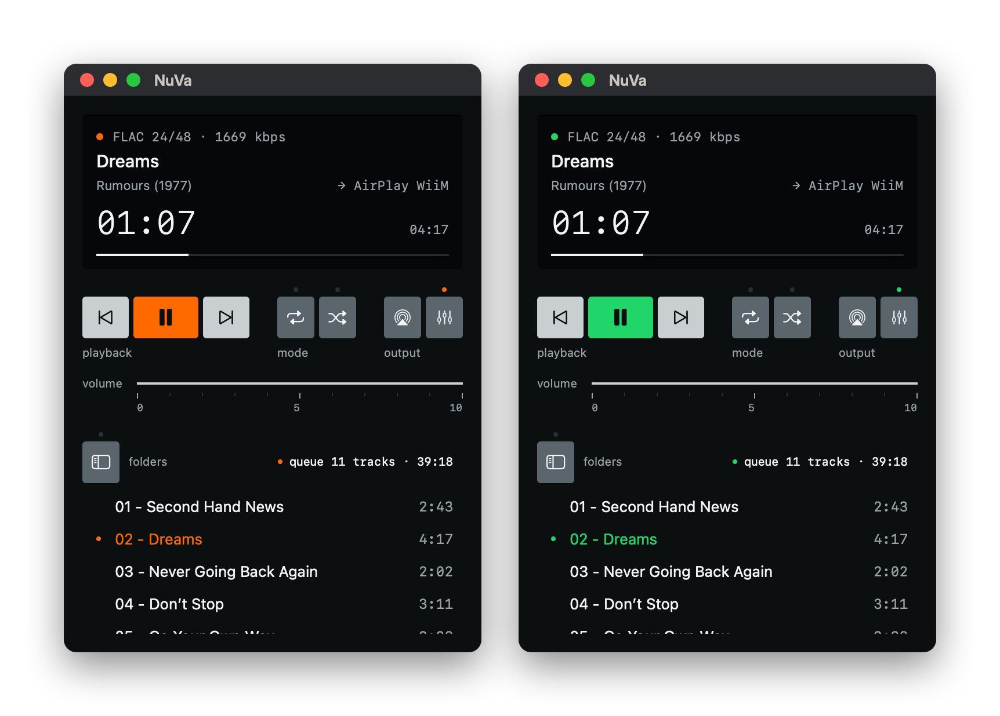
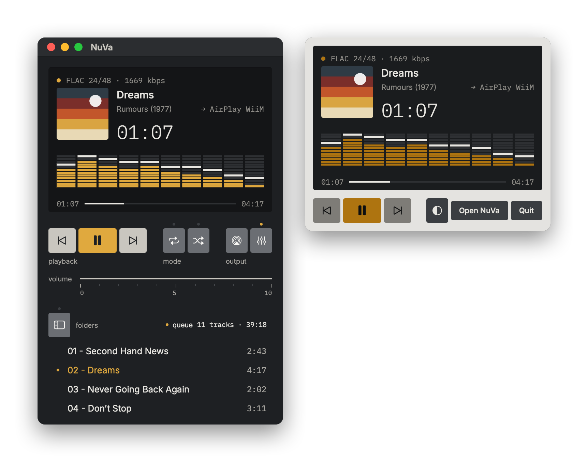
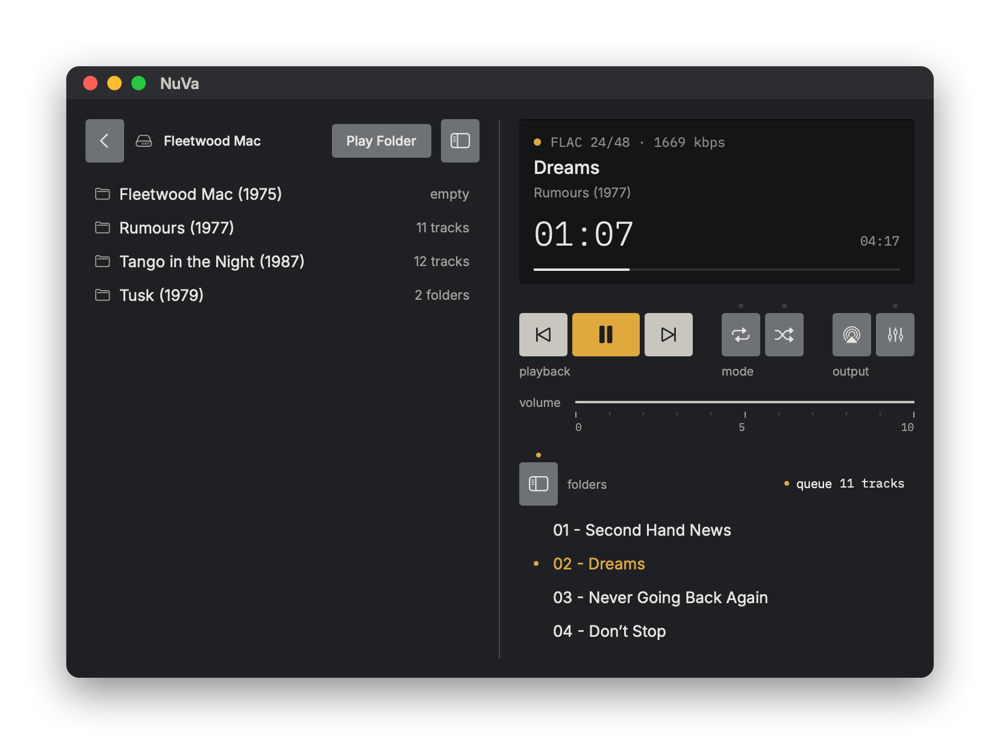
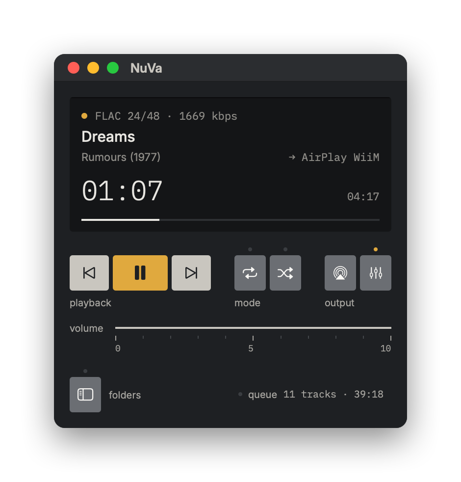
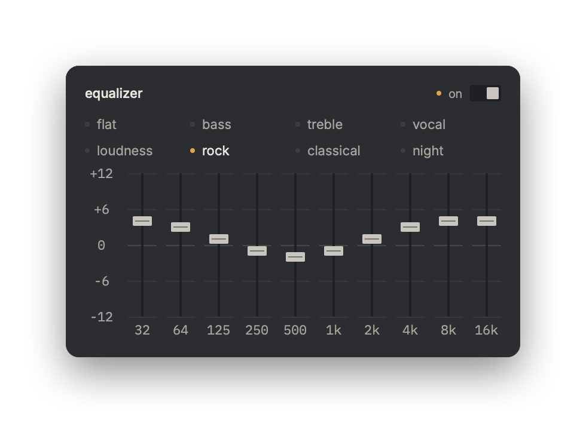
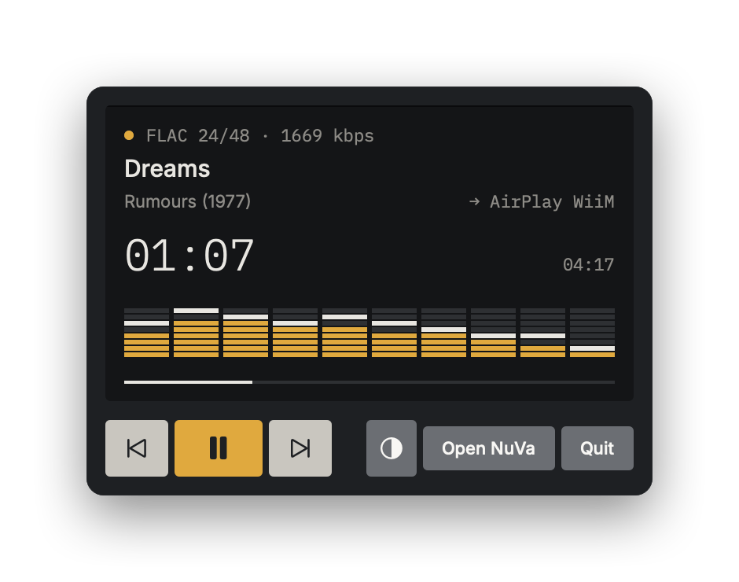
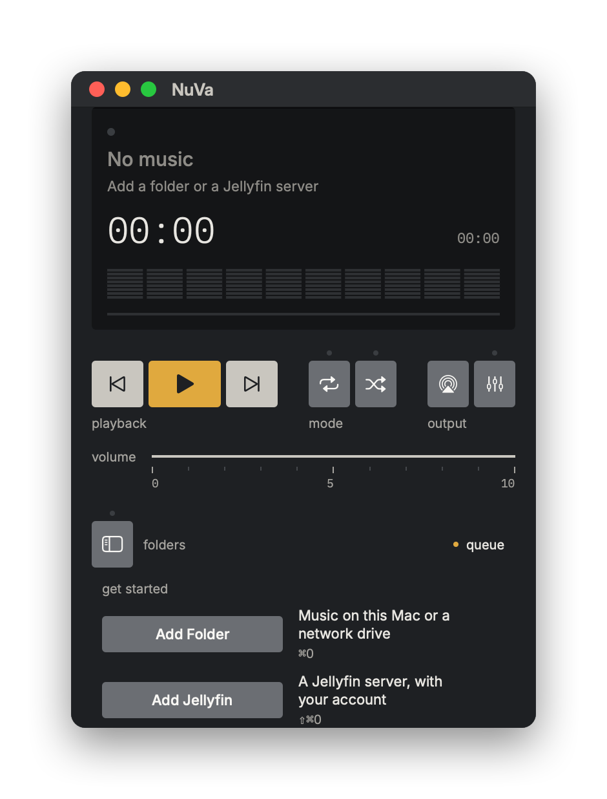

<p align="center">
  
</p>

<p align="center">
  <a href="https://github.com/martinsmdnuno/nuva/releases/latest/download/NuVa.dmg"></a>
</p>

<p align="center">
  
  
  
  
  <br>
  <b>English</b> · <a href="#português">Português</a>
</p>

---

**NuVa is a small, free music player for the Mac, made for people who keep their music in folders.**

You spent years naming your folders and files just right. Most players throw that away and rebuild your library from tags, so remixes, covers and live sets end up scattered across albums you've never heard of. NuVa doesn't. A folder is an album, a file is a track, and the names you see are the names you gave them.

It plays FLAC through Apple's own audio engine, sends it to your AirPlay speakers, and fits in a window the size of a hi-fi faceplate.

## Why you'll like it

<table>
<tr>
<td width="33%" valign="top">

**📁 Your folders, untouched**<br>
No import, no scanning, no tag clean-up. Point NuVa at a folder and play. Natural sort order, so track 2 comes before track 10.

</td>
<td width="33%" valign="top">

**🎧 Sounds the way it should**<br>
FLAC, ALAC, WAV and AIFF play through AVFoundation, the same engine as QuickTime. No bundled codecs, no surprises over Bluetooth.

</td>
<td width="33%" valign="top">

**📡 AirPlay 2 built in**<br>
Send the music to a WiiM, a HomePod, an Apple TV or any AirPlay speaker from the output key. The display shows where it's going.

</td>
</tr>
</table>

## A player that feels like hardware

<p align="center"></p>

NuVa borrows from Dieter Rams and classic Braun hi-fi: one flat panel, keys that say what they do by their colour, and small amber lights for what's on. An always-dark display shows the format, the bit depth and where the sound is going. It follows your Mac's appearance, in dark **Lead** or light **Aluminium**.

## Skins and fonts

<p align="center"></p>

The look above is the **Nuno** skin. **Graphite Orange** and **Graphite Green** are always dark, with a single bright accent on the play key, the lights and the playing track. Switch in **View › Skin** (⌥⌘1, ⌥⌘2, ⌥⌘3) or from the mini player. Skins change colours only: the keys, the layout and the shortcuts stay where your hands expect them. **View › Font** picks Inter + IBM Plex Mono or Apple's SF Pro + SF Mono.

## Album artwork, if you want it

<p align="center"></p>

Turn on **View › Show Artwork** (⌥⌘A) and NuVa shows the album cover in a small square on the display, in the mini player and in Control Center. Off by default.

- If the folder has an image (`cover`, `folder`, `front`, `album` or `capa`, as JPEG or PNG), that's the one. Your file always wins.
- If not, NuVa reads the artist and album from the folder names (`Fleetwood Mac/Rumours (1977)`) and fetches the cover from [MusicBrainz](https://musicbrainz.org) and the [Cover Art Archive](https://coverartarchive.org). Only confident matches count: no cover is better than a wrong one. Never from tags.
- Wrong or missing? Click the cover, or **View › Wrong or Missing Artwork…**: correct the artist or album and search again, or choose an image. NuVa keeps covers to itself and never writes into your folders.

## Browse folders, play a whole album

<p align="center"></p>

Open the folder drawer with the **folders** key or **⌘B**. Each folder shows how many tracks it holds; double-click one to play it from the top, or **⌘Enter** to add it to the queue. Drag the window taller to see the whole album at once, or double-click the title bar to fill the screen height.

## Audio CDs, like a CD player

Connect a CD drive and put a disc in: NuVa shows it as a source and plays it from the first track. A CD carries no names, so NuVa looks up the disc on [MusicBrainz](https://musicbrainz.org) by its table of contents and names the album and the tracks; if the disc isn't known, it stays "Audio CD" and "1 Audio Track". Eject with **⌘E** or the eject key.

To open NuVa whenever a CD goes in: **System Settings › CDs & DVDs › When you insert a music CD › Open other application… › NuVa**.

## Your Jellyfin server, without the mess

Sign in to a **Jellyfin** server with your own account and NuVa browses it by the server's real folders, not by Jellyfin's tags. It streams the original files, so a FLAC stays a FLAC. Your password goes in the macOS Keychain.

<table>
<tr>
<td width="50%" valign="top" align="center">
<br>
<b>Compact mode (⌘3)</b><br>
Just the display, the keys and the volume, for when the music is playing in the background.
</td>
<td width="50%" valign="top" align="center">
<br>
<b>10-band equalizer</b><br>
Presets for bass, treble, vocals, loudness and late nights, or set each band by hand.
</td>
</tr>
<tr>
<td width="50%" valign="top" align="center">
<br>
<b>Lives in the menu bar</b><br>
Close the window and the music keeps going. A mini player waits in the menu bar until you need it.
</td>
<td width="50%" valign="top" align="center">
<br>
<b>Ready in a minute</b><br>
On first launch NuVa tells you what to do: add a folder, or sign in to Jellyfin.
</td>
</tr>
</table>

## Everything else

- Plays FLAC, ALAC, MP3, AAC/M4A, WAV and AIFF.
- Folders on your Mac, on an external disk or on a mounted network share (SMB), and audio CDs.
- Queue: play a folder, add more, drag to reorder, delete to remove.
- Repeat (all or one), shuffle, seek, volume with a scroll of the mouse.
- Optional album artwork: the image in the folder, or found online from the folder names. Never from tags.
- Media keys, Control Center, the lock screen and AirPods controls.
- Keyboard first: every action has a shortcut.
- English and Portuguese, following your system language.
- No account, no analytics. It only goes online for your Jellyfin server, album covers (when artwork is on), the names of an audio CD and a daily check for new versions, which never downloads anything. See [Terms and privacy](TERMS.md), also in **NuVa › Terms and Privacy**.

## Install

1. **[Download NuVa.dmg](https://github.com/martinsmdnuno/nuva/releases/latest/download/NuVa.dmg)** and open it.
2. Drag **NuVa** to **Applications**.
3. Open NuVa. macOS will say it can't check the app, because NuVa isn't signed with a paid Apple developer certificate. Click **Done**.
4. Open **System Settings › Privacy & Security**, scroll down to *"NuVa was blocked"* and click **Open Anyway**.

You only do this once. After that, NuVa opens like any other app.

<details>
<summary>Prefer the Terminal?</summary>

After step 2:

```
xattr -dr com.apple.quarantine /Applications/NuVa.app
```
</details>

## Keyboard

| Shortcut | Action |
|---|---|
| Space | Play / pause |
| ⌘→ · ⌘← | Next · previous |
| ⌘↑ · ⌘↓ | Volume up · down |
| ⌘B | Show or hide folders |
| ⌘1 · ⌘2 · ⌘3 | Player · with browser · compact |
| ⌥⌘1 · ⌥⌘2 … | Skin (also in View ▸ Skin) |
| ⌥⌘A | Show or hide folder artwork |
| ⌘L | Go to the current track |
| Enter · ⌘Enter | Play the selection · add it to the queue |
| ⌘O · ⇧⌘O | Add a folder · add Jellyfin |
| ⌘E | Eject the CD |

## Build from source

You need Xcode 16 and [XcodeGen](https://github.com/yonaskolb/XcodeGen).

```
brew install xcodegen
xcodegen generate
open NuVa.xcodeproj
```

`scripts/make-dmg.sh` builds a universal release and the DMG in `dist/`. `scripts/make-readme-images.swift` builds the images on this page from the app's own snapshots. The design system lives in [`docs/design-system`](docs/design-system).

## Credits

Type: [Inter](https://github.com/rsms/inter) and [IBM Plex Mono](https://github.com/IBM/plex), both under the SIL Open Font License. Built with [Claude Code](https://claude.com/claude-code).

[MIT](LICENSE) © 2026 Nuno Martins

---

## Português

**A NuVa é um leitor de música pequeno e gratuito para Mac, para quem guarda a música em pastas.**

Passaste anos a dar o nome certo às pastas e aos ficheiros. A maioria dos leitores deita isso fora e refaz a biblioteca a partir das tags, e os remixes, covers e sets ao vivo acabam espalhados por álbuns que nunca ouviste. A NuVa não. Uma pasta é um álbum, um ficheiro é uma faixa, e os nomes que vês são os que lhes deste.

Toca FLAC pelo motor de áudio da própria Apple, envia o som para as tuas colunas AirPlay e cabe numa janela do tamanho da frente de um amplificador.

<p align="center">
  <a href="https://github.com/martinsmdnuno/nuva/releases/latest/download/NuVa.dmg"></a>
</p>

- **As tuas pastas, intocadas.** Sem importar, sem tags. Ordem natural: a faixa 2 vem antes da 10.
- **Soa como deve.** FLAC, ALAC, WAV e AIFF pelo AVFoundation, o mesmo motor do QuickTime.
- **AirPlay 2.** WiiM, HomePod, Apple TV ou qualquer coluna AirPlay.
- **Jellyfin sem confusão.** Navega pelas pastas reais do servidor e toca os ficheiros originais.
- **Três tamanhos.** Player, com navegador e compacto. A janela estica na vertical para veres o álbum inteiro.
- **Skins:** Nuno (claro ou escuro, como o sistema), Graphite Orange e Graphite Green (sempre escuras), em Visualização › Skin. Fonte Inter + IBM Plex Mono ou SF Pro + SF Mono, em Visualização › Fonte.
- **Capas, se quiseres:** Visualização › Mostrar capas (⌥⌘A). Usa a imagem da pasta (`cover`, `folder`, `front`, `album` ou `capa`); se não houver, procura no MusicBrainz pelo nome das pastas. Nunca das tags. Capa errada ou em falta: carrega na capa e corrige o artista ou o álbum, ou escolhe uma imagem. Desligado por defeito.
- **CDs áudio, como um leitor de CDs.** Mete um disco no leitor e a NuVa toca-o logo. Os nomes do álbum e das faixas vêm do MusicBrainz, pelo índice do disco (um CD não traz nomes). Ejetar com ⌘E. Para abrir a NuVa sempre que entra um CD: Definições do Sistema › CDs e DVDs › Ao inserir um CD de música › Abrir outra aplicação… › NuVa.
- **Avisa quando há versão nova** (verifica no GitHub uma vez por dia, sem descarregar nada). [Termos e privacidade](TERMS.md) em NuVa › Termos e privacidade.
- **Equalizador de 10 bandas**, media keys, Centro de Controlo e mini player na barra de menus.
- Em português e inglês, conforme a língua do sistema. macOS 14 ou posterior, Apple silicon e Intel.

### Instalar

1. **[Descarregar NuVa.dmg](https://github.com/martinsmdnuno/nuva/releases/latest/download/NuVa.dmg)** e abrir.
2. Arrastar a **NuVa** para **Aplicações**.
3. Abrir a NuVa. O macOS diz que não consegue verificar a app, porque a NuVa não está assinada com um certificado pago da Apple. Carregar em **OK**.
4. Abrir **Definições do Sistema › Privacidade e segurança**, descer até *"A NuVa foi bloqueada"* e carregar em **Abrir mesmo assim**.

Só é preciso uma vez.

Atalhos: Espaço tocar/pausa · ⌘→ ⌘← seguinte/anterior · ⌘↑ ⌘↓ volume · ⌘B pastas · ⌘1 ⌘2 ⌘3 tamanho da janela · ⌥⌘1 ⌥⌘2 … skin · ⌥⌘A capas · ⌘L faixa atual · ⌘O adicionar pasta · ⇧⌘O adicionar Jellyfin.
