<p align="center">
  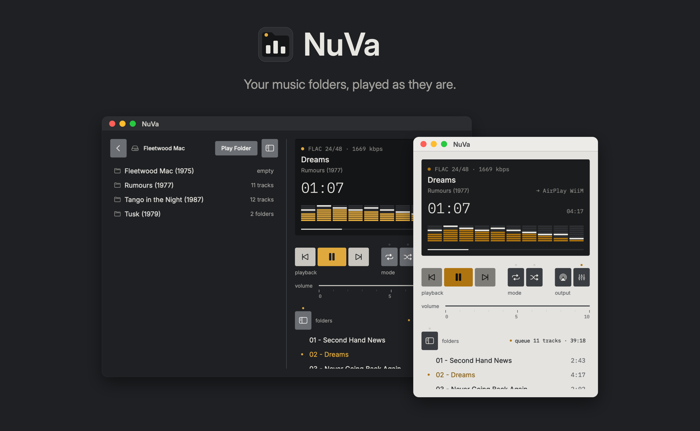
</p>

<p align="center">
<!-- nuva:downloads -->
  <a href="https://github.com/martinsmdnuno/nuva/releases/latest/download/NuVa.dmg"></a>
  <a href="#nuva-for-android-tv"></a>
<!-- /nuva:downloads -->
</p>

<p align="center">
  
<!-- nuva:requirements -->
  
  
  
<!-- /nuva:requirements -->
  
  <br>
  <b>English</b> · <a href="#português">Português</a>
</p>

---

**NuVa is a small, free music player for the Mac, made for people who keep their music in folders.**

You spent years naming your folders and files just right. Most players throw that away and rebuild your library from tags, so remixes, covers and live sets end up scattered across albums you've never heard of. NuVa doesn't. A folder is an album, a file is a track, and the names you see are the names you gave them.

It plays FLAC through Apple's own audio engine, sends it to your AirPlay speakers, and fits in a window the size of a hi-fi faceplate.

## Why you'll like it

<table>
<tr>
<td width="33%" valign="top">

**📁 Your folders, untouched**<br>
No import, no scanning, no tag clean-up. Point NuVa at a folder and play. Natural sort order, so track 2 comes before track 10.

</td>
<td width="33%" valign="top">

**🎧 Sounds the way it should**<br>
FLAC, ALAC, WAV and AIFF play through AVFoundation, the same engine as QuickTime. No bundled codecs, no surprises over Bluetooth.

</td>
<td width="33%" valign="top">

**📡 AirPlay 2 built in**<br>
Send the music to a WiiM, a HomePod, an Apple TV or any AirPlay speaker: click where the display says the sound is going.

</td>
</tr>
</table>

## A player that feels like hardware

<p align="center">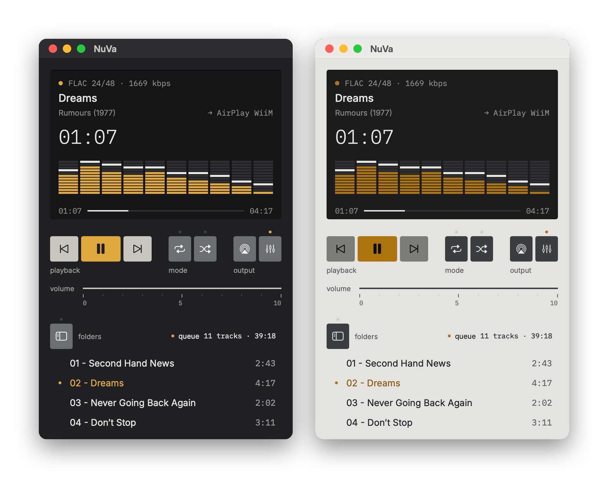</p>

NuVa borrows from Dieter Rams and classic Braun hi-fi: one flat panel, keys that say what they do by their colour, small amber lights for what's on, and a volume knob. Shuffle and repeat on the left, play in the middle, volume on the right. An always-dark display shows the format, the bit depth, where the sound is going and the equalizer preset (click either to change it), with a spectrum meter of amber segments that dances with the music, one column per equalizer band. It follows your Mac's appearance, in dark **Lead** or light **Aluminium**.

## Skins and fonts

<p align="center">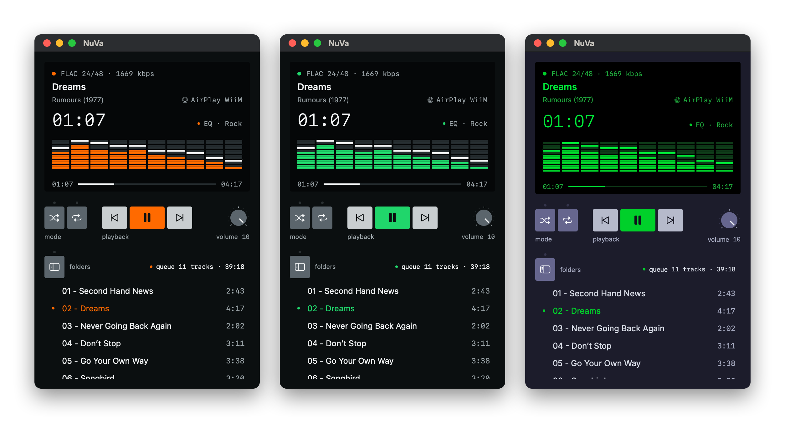</p>

The look above is the **Rams** skin. **Graphite Orange** is always dark, with a single bright orange accent on the play key, the lights and the playing track. **Phosphor** is a nod to the shareware players of the late nineties: a black screen with green text and a blue-grey chassis. Switch in **View › Skin** (⌥⌘1 to ⌥⌘3) or from the mini player. Skins change colours only: the keys, the layout and the shortcuts stay where your hands expect them. **View › Font** picks the type, in five pairs: Inter + IBM Plex Mono, Apple's SF Pro + SF Mono, and three chosen for the skins: **IBM Plex Sans** for Rams, **DM Sans** for Graphite Orange and **Share Tech**, a digital readout, for Phosphor.

<p align="center">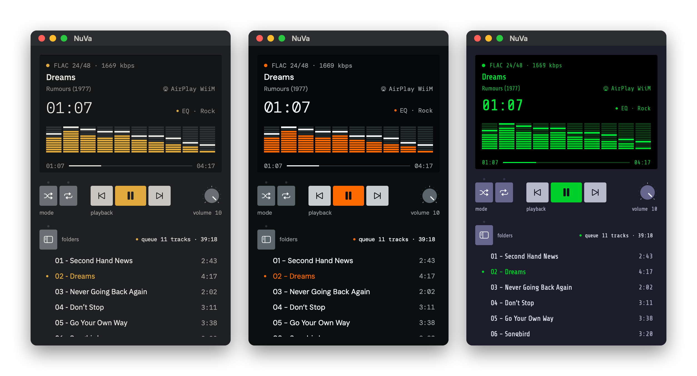</p>

## Ambient mode, for the room

<p align="center">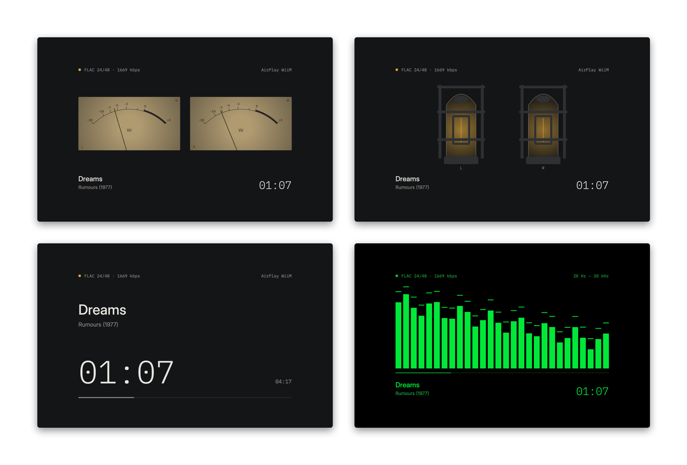</p>

**View › Ambient** (⌘4) turns the whole screen into NuVa's display, in the current skin, to leave the music playing as part of the room. Six faces, ← → to switch:

- **Display**: the track and the time, large.
- **Clock**: the time of day.
- **Spectrum**: 28 bands from 20 Hz to 20 kHz, with a peak line over each.
- **Meters**: left and right levels.
- **Needles**: two backlit VU meters under glass. The needles move like real ones: a damped spring that takes 300 ms to settle, overshoots a hair and rests on its pin.
- **Valves**: two valves in their cage, whose filaments glow with each channel.

They all move with what you hear, AirPlay included, drawn at your screen's own rate (120 Hz on a ProMotion Mac or a 120 Hz TV). With artwork on, the screen takes on the album's colours: a soft, blurred glow made from the cover itself, behind the face; on the Display face it breathes with the bass. Esc or ⌘4 leaves. It can go on another screen or a TV (**View › Ambient Options**), and keeps the screen awake while music plays. **OLED Protection**, on by default, looks after OLED screens: the picture drifts slowly, static parts are dimmer, the face changes every 20 minutes, and after an hour untouched only a small light is left.

## Album artwork, if you want it

<p align="center">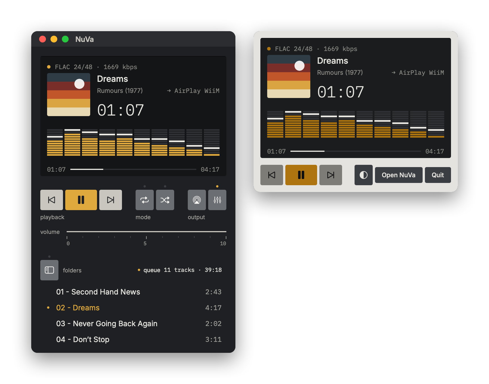</p>

Turn on **View › Show Artwork** (⌥⌘A) and NuVa shows the album cover in a small square on the display, in the mini player and in Control Center. Off by default.

- If the folder has an image (`cover`, `folder`, `front`, `album` or `capa`, as JPEG or PNG), that's the one. Your file always wins.
- If not, NuVa reads the artist and album from the folder names (`Fleetwood Mac/Rumours (1977)`) and fetches the cover from [MusicBrainz](https://musicbrainz.org) and the [Cover Art Archive](https://coverartarchive.org). Only confident matches count: no cover is better than a wrong one. Never from tags.
- Wrong or missing? Click the cover, or **View › Wrong or Missing Artwork…**: correct the artist or album and search again, or choose an image. NuVa keeps covers to itself and never writes into your folders.

## Browse folders, play a whole album

<p align="center">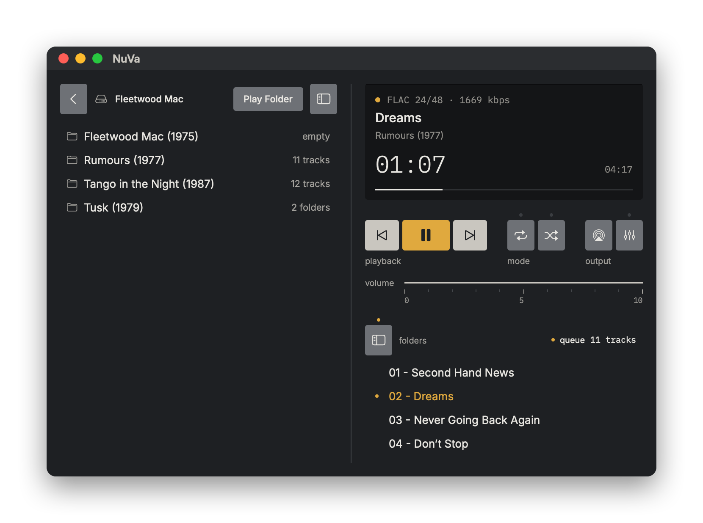</p>

Press the **folders** key or **⌘B** and your folders take the queue's place, below the keys; press it again for the queue. Each folder shows how many tracks it holds; double-click one to play it from the top (the queue comes back with it), or **⌘Enter** to add it to the queue. Drag the window taller to see the whole album at once, or wider for long file names.

## Audio CDs, like a CD player

Connect a CD drive and put a disc in: NuVa shows it as a source and plays it from the first track. A CD carries no names, so NuVa looks up the disc on [MusicBrainz](https://musicbrainz.org) by its table of contents and names the album and the tracks; if the disc isn't known, it stays "Audio CD" and "1 Audio Track". Eject with **⌘E** or the eject key.

To open NuVa whenever a CD goes in: **System Settings › CDs & DVDs › When you insert a music CD › Open other application… › NuVa**.

## Your Jellyfin server, without the mess

Sign in to a **Jellyfin** server with your own account and NuVa browses it by the server's real folders, not by Jellyfin's tags. It streams the original files, so a FLAC stays a FLAC. Your password goes in the macOS Keychain.

<table>
<tr>
<td width="50%" valign="top" align="center">
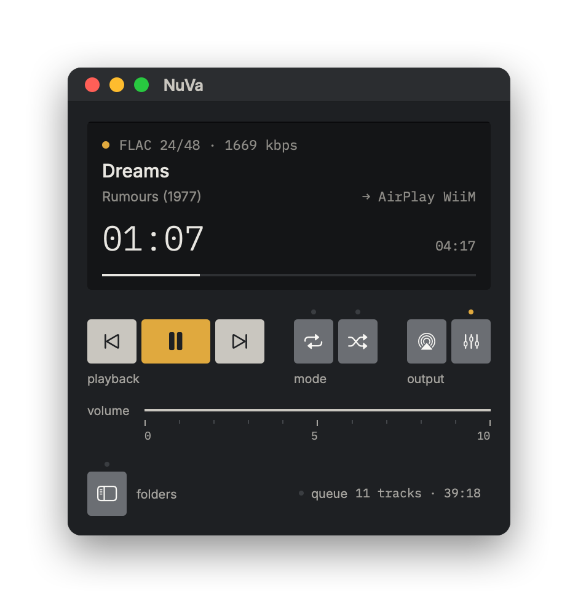<br>
<b>Compact mode (⌘3)</b><br>
Just the display and the keys, volume knob included, for when the music is playing in the background.
</td>
<td width="50%" valign="top" align="center">
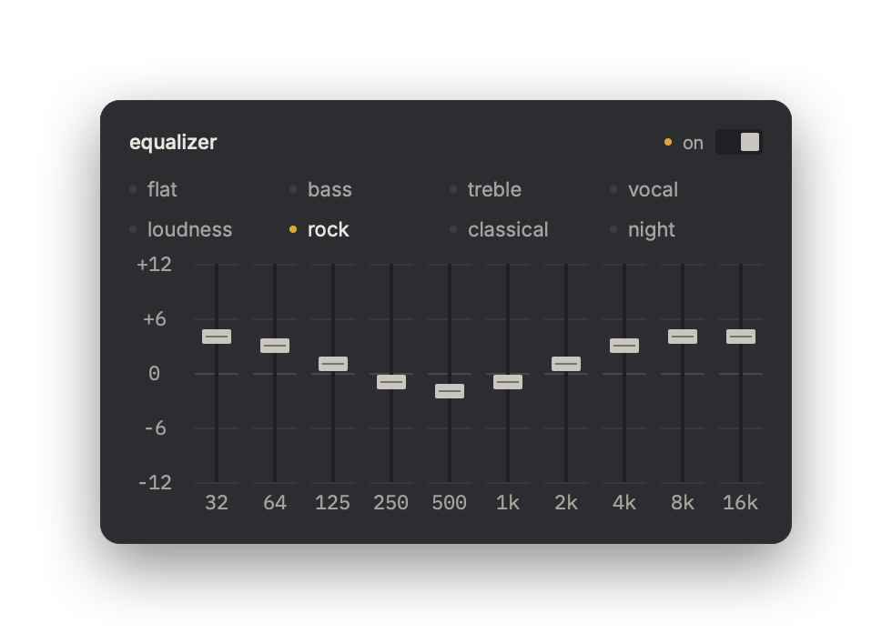<br>
<b>10-band equalizer</b><br>
Presets for bass, treble, vocals, loudness and late nights, or set each band by hand. Click "EQ" on the display or press ⌥⌘E.
</td>
</tr>
<tr>
<td width="50%" valign="top" align="center">
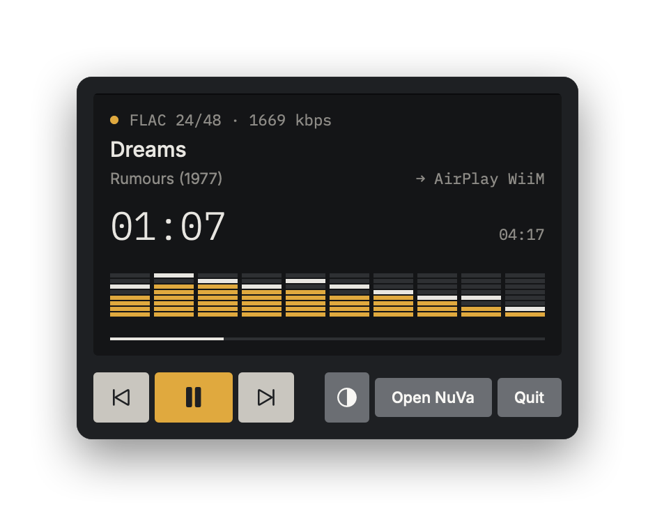<br>
<b>Lives in the menu bar</b><br>
Close the window and the music keeps going. A mini player waits in the menu bar until you need it.
</td>
<td width="50%" valign="top" align="center">
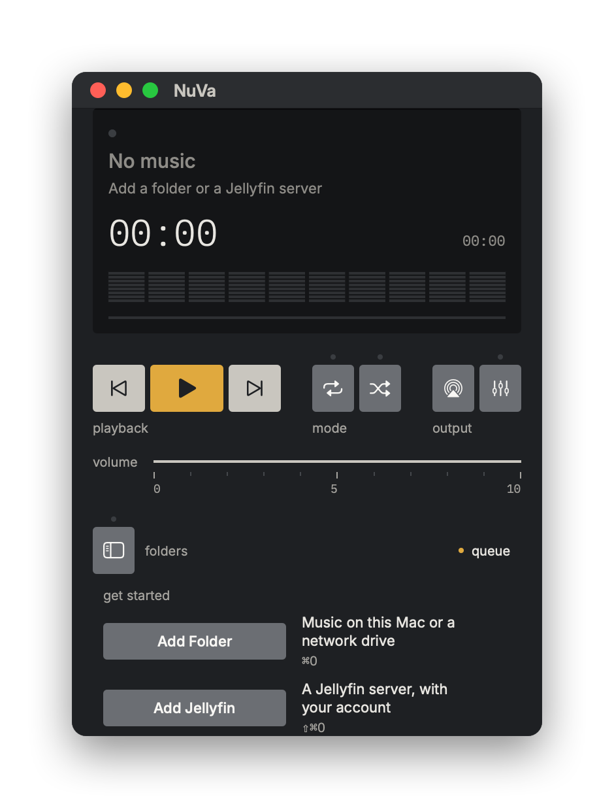<br>
<b>Ready in a minute</b><br>
On first launch NuVa tells you what to do: add a folder, or sign in to Jellyfin.
</td>
</tr>
</table>

## NuVa for Android TV

<p align="center">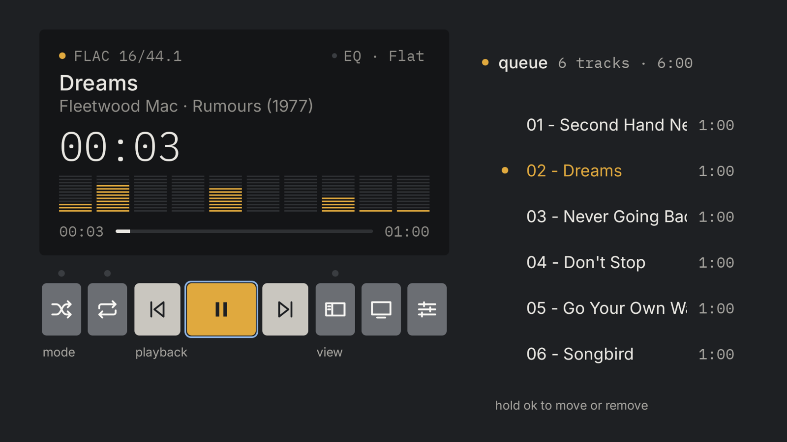</p>

The same player for the living room, on an Android TV box or a TV with Android TV (8.1 or later). It plays your **Jellyfin** server by its real folders and streams the original files: FLAC, 24-bit included, through Android's own player and decoders. It has what the Mac app has where a TV allows: the display with the spectrum, the 10-band equalizer, the queue, repeat and shuffle, all six ambient faces with OLED protection, album artwork with the cover's glow, the skins and font sets. The remote does everything: hold OK to add to the queue, or to move and remove; Back asks before leaving. It reopens where you were.

To install it, open the **Downloader** app on the TV (free, in the Play Store) and type `nuva.martinsnuno.com/tv`. Or download [NuVa-AndroidTV.apk](https://github.com/martinsmdnuno/nuva/releases/latest/download/NuVa-AndroidTV.apk) and copy it with a USB stick. Android asks once to allow apps from Downloader (or from the file manager).

## Everything else

- Plays FLAC, ALAC, MP3, AAC/M4A, WAV and AIFF.
- Folders on your Mac, on an external disk or on a mounted network share (SMB), and audio CDs.
- Queue: play a folder, add more, drag to reorder, delete to remove.
- Repeat (all or one), shuffle, seek, and a volume knob you can drag, scroll or turn with ⌘↑ ⌘↓.
- A 10-band equalizer with presets, and a spectrum meter on the display that follows what you hear, also over AirPlay (**View › Show Spectrum**, ⌥⌘V).
- Optional album artwork: the image in the folder, or found online from the folder names. Never from tags.
- Media keys, Control Center, the lock screen and AirPods controls.
- Keyboard first: every action has a shortcut. VoiceOver reads the keys, the sliders and every row.
- Keeps going: a damaged file or a server that went offline is tried once more, then skipped, and the display says which track couldn't play. A disk or NAS that wasn't connected comes back when it's mounted.
- English and Portuguese, following your system language.
- No account, no analytics. It only goes online for your Jellyfin server, album covers (when artwork is on), the names of an audio CD and a daily check for new versions, which never downloads anything. See [Terms and privacy](TERMS.md), also in **NuVa › Terms and Privacy**.

## Which app does what

<!-- nuva:platforms -->
| | Mac | Android TV |
|---|:-:|:-:|
| Folders as they are: a folder is an album, natural sort, never tags | ✓ | ✓ |
| Folders on the computer, external disks and network shares | ✓ | — |
| Jellyfin by its real folders, streaming the original file | ✓ | ✓ |
| Audio CDs, named from MusicBrainz | ✓ | — |
| FLAC, 24-bit included, through the system's own audio engine | ✓ | ✓ |
| AirPlay 2 to a WiiM, HomePod or Apple TV | ✓ | — |
| Queue: play a folder, add, reorder, remove | ✓ | ✓ |
| Repeat, shuffle, seek and 10-second skips | ✓ | ✓ |
| 10-band equalizer with presets | ✓ | ✓ |
| Spectrum on the display, in time with what you hear | ✓ | ✓ |
| Ambient mode: six full-screen faces, with OLED protection | ✓ | ✓ |
| Album artwork: the folder's image, then MusicBrainz by folder names | ✓ | ✓ |
| Correct a wrong or missing cover | ✓ | later |
| Skins (Rams, Graphite Orange, Phosphor) and five font pairs | ✓ | ✓ |
| Compact mode, and a mini player when the window is closed | ✓ | — |
| A keyboard shortcut for everything | ✓ | — |
| Everything from a TV remote | — | ✓ |
| Media keys and the system's Now Playing controls | ✓ | ✓ |
| Reopens where you left off | later | ✓ |
| A track that fails is tried again, then skipped, and the display says so | ✓ | later |
| Screen reader: every key, control and row is read | ✓ | later |
| English and Portuguese, following the system | ✓ | ✓ |
| Says when there's a new version; never downloads by itself | ✓ | ✓ |
| No account, no analytics | ✓ | ✓ |

*Later*: on its way. —: doesn't apply on that platform.
<!-- /nuva:platforms -->

## Install

1. **[Download NuVa.dmg](https://github.com/martinsmdnuno/nuva/releases/latest/download/NuVa.dmg)** and open it.
2. Drag **NuVa** to **Applications**.
3. Open NuVa. macOS will say it can't check the app, because NuVa isn't signed with a paid Apple developer certificate. Click **Done**.
4. Open **System Settings › Privacy & Security**, scroll down to *"NuVa was blocked"* and click **Open Anyway**.

You only do this once. After that, NuVa opens like any other app.

<details>
<summary>Prefer the Terminal?</summary>

After step 2:

```
xattr -dr com.apple.quarantine /Applications/NuVa.app
```
</details>

## Keyboard

| Shortcut | Action |
|---|---|
| Space | Play / pause |
| ⌘→ · ⌘← | Next · previous |
| ⇧⌘→ · ⇧⌘← | Forward · back 10 seconds |
| ⌘. | Stop |
| ⌘↑ · ⌘↓ | Volume up · down |
| ⌘R · ⌥⌘S | Repeat · shuffle |
| ⌥⌘E | Equalizer |
| ⌘B | Swap the queue and the folders |
| ⌘1 · ⌘2 · ⌘3 | Queue · folders · compact |
| ⌘4 | Ambient (full screen; ← → faces, Esc leaves) |
| ⌥⌘1 · ⌥⌘2 … | Skin (also in View ▸ Skin) |
| ⌥⌘A | Show or hide folder artwork |
| ⌥⌘V | Show or hide the spectrum meter |
| ⌘L | Go to the current track |
| ⌥⌘↑ · ⌥⌘↓ | Move the selected track up · down in the queue |
| Delete · ⌥⌘⌫ | Remove the selected track · clear the queue |
| Enter · ⌘Enter | Play the selection · add it to the queue |
| ⌘O · ⇧⌘O | Add a folder · add Jellyfin |
| ⌘E | Eject the CD |

## Build from source

You need Xcode 16 and [XcodeGen](https://github.com/yonaskolb/XcodeGen).

```
brew install xcodegen
xcodegen generate
open NuVa.xcodeproj
```

`scripts/make-dmg.sh` builds a universal release and the DMG in `dist/`. The Android TV app is in [`android/`](android) (Kotlin, Jetpack Compose for TV and Media3; see [its plan](docs/plans/android-tv.md)); `scripts/make-apk.sh` builds the signed APK. `scripts/make-readme-images.swift` builds the images on this page from the app's own snapshots. The design system lives in [`docs/design-system`](docs/design-system).

## Credits

Type: [Inter](https://github.com/rsms/inter), [IBM Plex](https://github.com/IBM/plex), [DM Sans and DM Mono](https://github.com/googlefonts/dm-fonts) and [Share Tech](https://fonts.google.com/specimen/Share+Tech), all under the SIL Open Font License. Built with [Claude Code](https://claude.com/claude-code).

[MIT](LICENSE) © 2026 Nuno Martins

---

## Português

**A NuVa é um leitor de música pequeno e gratuito para Mac, para quem guarda a música em pastas.**

Passaste anos a dar o nome certo às pastas e aos ficheiros. A maioria dos leitores deita isso fora e refaz a biblioteca a partir das tags, e os remixes, covers e sets ao vivo acabam espalhados por álbuns que nunca ouviste. A NuVa não. Uma pasta é um álbum, um ficheiro é uma faixa, e os nomes que vês são os que lhes deste.

Toca FLAC pelo motor de áudio da própria Apple, envia o som para as tuas colunas AirPlay e cabe numa janela do tamanho da frente de um amplificador.

<p align="center">
<!-- nuva:downloads-pt -->
  <a href="https://github.com/martinsmdnuno/nuva/releases/latest/download/NuVa.dmg"></a>
  <a href="#na-tv-nuva-para-android-tv"></a>
<!-- /nuva:downloads-pt -->
</p>

- **As tuas pastas, intocadas.** Sem importar, sem tags. Ordem natural: a faixa 2 vem antes da 10.
- **Soa como deve.** FLAC, ALAC, WAV e AIFF pelo AVFoundation, o mesmo motor do QuickTime.
- **AirPlay 2.** WiiM, HomePod, Apple TV ou qualquer coluna AirPlay: carrega na saída que aparece no visor.
- **Jellyfin sem confusão.** Navega pelas pastas reais do servidor e toca os ficheiros originais.
- **Uma janela pequena.** As pastas aparecem no lugar da fila (⌘B troca as duas) e há um modo compacto. A janela estica na vertical para veres o álbum inteiro, e na horizontal para nomes compridos.
- **Skins:** Rams (claro ou escuro, como o sistema), Graphite Orange e Phosphor (sempre escuras), em Visualização › Skin. Cinco pares de fontes em Visualização › Fonte: Inter + IBM Plex Mono, SF Pro + SF Mono, IBM Plex Sans (para a Rams), DM Sans (para a Graphite Orange) e Share Tech (para a Phosphor).
- **Modo Ambiente** (⌘4): o ecrã inteiro passa a ser o mostrador da NuVa, na skin atual. Seis faces, ← → trocam: a faixa e o tempo em grande, um relógio, o espectro de 28 bandas, os medidores esquerdo e direito, dois VU de ponteiro que se mexem como os verdadeiros e duas válvulas que acendem com cada canal, a 120 Hz nos ecrãs que o têm. Com as capas ligadas, o ecrã ganha as cores do álbum, num brilho desfocado feito da própria capa; na face do ecrã, respira com os graves. Esc sai. Pode ir para outro ecrã ou uma TV. Protege ecrãs OLED: a imagem desloca-se devagar, o que é fixo fica mais escuro, a face muda a cada 20 minutos e, ao fim de uma hora sem mexer, só fica uma pequena luz.
- **Capas, se quiseres:** Visualização › Mostrar capas (⌥⌘A). Usa a imagem da pasta (`cover`, `folder`, `front`, `album` ou `capa`); se não houver, procura no MusicBrainz pelo nome das pastas. Nunca das tags. Capa errada ou em falta: carrega na capa e corrige o artista ou o álbum, ou escolhe uma imagem. Desligado por defeito.
- **CDs áudio, como um leitor de CDs.** Mete um disco no leitor e a NuVa toca-o logo. Os nomes do álbum e das faixas vêm do MusicBrainz, pelo índice do disco (um CD não traz nomes). Ejetar com ⌘E. Para abrir a NuVa sempre que entra um CD: Definições do Sistema › CDs e DVDs › Ao inserir um CD de música › Abrir outra aplicação… › NuVa.
- **Avisa quando há versão nova** (verifica no GitHub uma vez por dia, sem descarregar nada). [Termos e privacidade](TERMS.md) em NuVa › Termos e privacidade.
- **Teclas como num deck:** aleatório e repetir à esquerda, tocar ao centro, botão de volume à direita.
- **Equalizador de 10 bandas** (carrega em "EQ" no visor ou ⌥⌘E) e **espectro no visor**: colunas de segmentos âmbar, uma por banda, que seguem o que estás a ouvir, também em AirPlay (Visualização › Mostrar espectro, ⌥⌘V).
- Media keys, Centro de Controlo e mini player na barra de menus. Tudo tem atalho de teclado, e o VoiceOver lê as teclas, os controlos e cada linha.
- **Não pára por qualquer coisa:** um ficheiro danificado ou um servidor que foi abaixo é tentado mais uma vez e depois saltado, e o visor diz que faixa não tocou. Um disco ou NAS que não estava ligado volta quando é montado.
- Em português e inglês, conforme a língua do sistema. macOS 14 ou posterior, Apple silicon e Intel.

### Na TV: NuVa para Android TV

O mesmo leitor para a sala, numa box Android TV ou numa TV com Android TV (8.1 ou posterior). Toca o teu servidor **Jellyfin** pelas pastas reais e os ficheiros originais: FLAC, 24 bits incluídos, pelo leitor e pelos descodificadores do próprio Android. Tem o que a app do Mac tem onde uma TV deixa: o visor com o espectro, o equalizador de 10 bandas, a fila, repetir e aleatório, as seis faces do modo Ambiente com proteção OLED, as capas com o brilho do álbum, as skins e as fontes. O comando faz tudo: manter OK carregado junta à fila, ou move e tira; Voltar pergunta antes de sair. Volta a abrir onde estavas.

Para instalar, abre a app **Downloader** na TV (gratuita, na Play Store) e escreve `nuva.martinsnuno.com/tv`. Ou descarrega o [NuVa-AndroidTV.apk](https://github.com/martinsmdnuno/nuva/releases/latest/download/NuVa-AndroidTV.apk) e copia-o com uma pen USB. O Android pede uma vez para permitir apps vindas do Downloader (ou do gestor de ficheiros).

### O que faz cada app

<!-- nuva:platforms-pt -->
| | Mac | Android TV |
|---|:-:|:-:|
| Pastas como estão: uma pasta é um álbum, ordem natural, nunca tags | ✓ | ✓ |
| Pastas no computador, discos externos e partilhas de rede | ✓ | — |
| Jellyfin pelas pastas reais, com o ficheiro original | ✓ | ✓ |
| CDs áudio, com os nomes do MusicBrainz | ✓ | — |
| FLAC, 24 bits incluídos, pelo motor de áudio do próprio sistema | ✓ | ✓ |
| AirPlay 2 para um WiiM, HomePod ou Apple TV | ✓ | — |
| Fila: tocar uma pasta, juntar, reordenar, tirar | ✓ | ✓ |
| Repetir, aleatório, posição e saltos de 10 segundos | ✓ | ✓ |
| Equalizador de 10 bandas com presets | ✓ | ✓ |
| Espectro no visor, a par com o que ouves | ✓ | ✓ |
| Modo Ambiente: seis faces em ecrã inteiro, com proteção OLED | ✓ | ✓ |
| Capas: a imagem da pasta, depois o MusicBrainz pelos nomes das pastas | ✓ | ✓ |
| Corrigir uma capa errada ou em falta | ✓ | mais tarde |
| Skins (Rams, Graphite Orange, Phosphor) e cinco pares de fontes | ✓ | ✓ |
| Modo compacto, e um mini player com a janela fechada | ✓ | — |
| Um atalho de teclado para tudo | ✓ | — |
| Tudo com o comando da TV | — | ✓ |
| Teclas multimédia e os controlos de reprodução do sistema | ✓ | ✓ |
| Volta a abrir onde ficaste | mais tarde | ✓ |
| Uma faixa que falha é tentada outra vez e saltada, e o visor diz qual | ✓ | mais tarde |
| Leitor de ecrã: lê cada tecla, controlo e linha | ✓ | mais tarde |
| Português e inglês, conforme o sistema | ✓ | ✓ |
| Avisa quando há versão nova; nunca descarrega sozinha | ✓ | ✓ |
| Sem conta, sem analytics | ✓ | ✓ |

*Mais tarde*: a caminho. —: não se aplica nessa plataforma.
<!-- /nuva:platforms-pt -->

### Instalar

1. **[Descarregar NuVa.dmg](https://github.com/martinsmdnuno/nuva/releases/latest/download/NuVa.dmg)** e abrir.
2. Arrastar a **NuVa** para **Aplicações**.
3. Abrir a NuVa. O macOS diz que não consegue verificar a app, porque a NuVa não está assinada com um certificado pago da Apple. Carregar em **OK**.
4. Abrir **Definições do Sistema › Privacidade e segurança**, descer até *"A NuVa foi bloqueada"* e carregar em **Abrir mesmo assim**.

Só é preciso uma vez.

Atalhos: Espaço tocar/pausa · ⌘→ ⌘← seguinte/anterior · ⇧⌘→ ⇧⌘← avançar/recuar 10 s · ⌘. parar · ⌘↑ ⌘↓ volume · ⌘R ⌥⌘S repetir, aleatório · ⌥⌘↑ ⌥⌘↓ mover na fila · ⌥⌘⌫ limpar fila · ⌥⌘E equalizador · ⌘B fila ou pastas · ⌘1 ⌘2 ⌘3 fila, pastas, compacto · ⌘4 ambiente · ⌥⌘1 ⌥⌘2 … skin · ⌥⌘A capas · ⌥⌘V espectro · ⌘L faixa atual · ⌘O adicionar pasta · ⇧⌘O adicionar Jellyfin · ⌘E ejetar CD.
