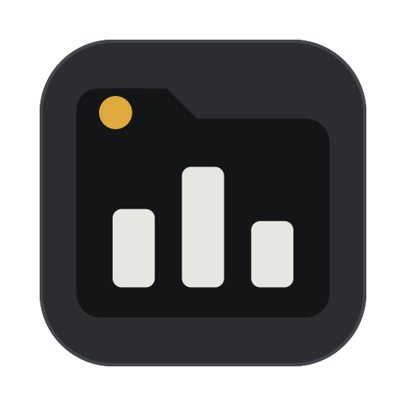
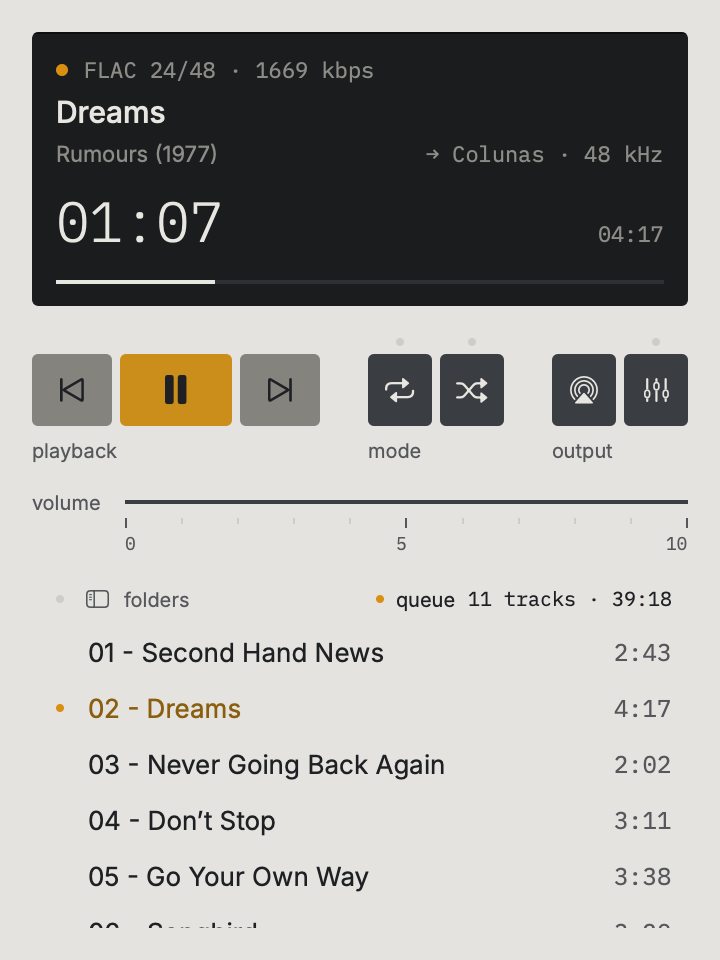

<p align="center"></p>

<h1 align="center">NuVa</h1>

<p align="center">A small music player for macOS that plays your folders as they are.<br>
<a href="https://github.com/martinsmdnuno/nuva/releases/latest/download/NuVa.dmg"><b>Download NuVa for Mac</b></a> · macOS 14 or later · Apple silicon and Intel<br>
<a href="#português">Português</a></p>

<p align="center"></p>

## Why

- **Folders, not tags.** A folder is an album. NuVa shows folder and file names exactly as they are, so remixes, covers and mixes stay where you put them.
- **FLAC and the native audio engine.** NuVa plays through Apple's own audio engine (AVFoundation). It sounds like QuickTime, also over Bluetooth headphones.
- **AirPlay 2.** Send the sound to a WiiM, a HomePod or any AirPlay speaker.
- **One small window.** No library to build, no accounts, nothing to sync.

## What it does

- Plays FLAC, ALAC, MP3, AAC/M4A, WAV and AIFF.
- Music from a folder on your Mac or a network drive, or from a **Jellyfin** server (it browses the server's folders and plays the original files).
- Queue: play a folder, add more, reorder, remove.
- Play/pause, previous, next, seek, volume, repeat, shuffle.
- 10-band equalizer with presets.
- Media keys, Control Center and the lock screen.
- Three window sizes: player with queue, with folder browser, and compact. The window grows vertically to show a whole album.
- Closing the window keeps the music playing in a mini player in the menu bar.
- English and Portuguese, following your system language.

<p align="center">


</p>

## Install

1. [Download NuVa.dmg](https://github.com/martinsmdnuno/nuva/releases/latest/download/NuVa.dmg) and open it.
2. Drag **NuVa** to **Applications**.
3. Open NuVa. macOS says it can't check the app, because NuVa isn't signed with a paid Apple certificate. Click **Done** (or **OK**).
4. Open **System Settings › Privacy & Security**, scroll down to *"NuVa was blocked"* and click **Open Anyway**. Confirm with your password.

You only need to do this once. After that NuVa opens like any other app.

<details>
<summary>Prefer the Terminal?</summary>

After step 2, run:

```
xattr -dr com.apple.quarantine /Applications/NuVa.app
```
</details>

## First steps

- **Add Folder** (⌘O): pick the folder with your music. Folders on a mounted network drive work too.
- **Add Jellyfin** (⇧⌘O): the server address, your username and password. The password is kept in your Keychain.
- **folders** (⌘B) opens the folder drawer. Double-click a folder, or press Enter, to play it.

| Shortcut | Action |
|---|---|
| Space | Play / pause |
| ⌘→ / ⌘← | Next / previous |
| ⌘↑ / ⌘↓ | Volume |
| ⌘B | Show or hide folders |
| ⌘1 ⌘2 ⌘3 | Player · with browser · compact |
| ⌘L | Go to the current track |
| Enter / ⌘Enter | Play the selection / add it to the queue |

## Build from source

You need Xcode 16 and [XcodeGen](https://github.com/yonaskolb/XcodeGen).

```
brew install xcodegen
xcodegen generate
open NuVa.xcodeproj
```

`scripts/make-dmg.sh` builds a universal release and the DMG in `dist/`. The design system lives in [`docs/design-system`](docs/design-system).

## Credits

Type: [Inter](https://github.com/rsms/inter) and [IBM Plex Mono](https://github.com/IBM/plex), both under the SIL Open Font License. Built with Claude Code.

## License

[MIT](LICENSE) © 2026 Nuno Martins

---

## Português

Um leitor de música pequeno para macOS que toca as tuas pastas tal como estão.

**[Descarregar a NuVa para Mac](https://github.com/martinsmdnuno/nuva/releases/latest/download/NuVa.dmg)** · macOS 14 ou posterior · Apple silicon e Intel

### Porquê

- **Pastas, não tags.** Uma pasta é um álbum. A NuVa mostra os nomes das pastas e dos ficheiros tal como estão, e os remixes, covers e mixes ficam onde os puseste.
- **FLAC e o motor de áudio nativo.** A NuVa toca pelo motor de áudio da Apple (AVFoundation). Soa como o QuickTime, também com auscultadores Bluetooth.
- **AirPlay 2.** Envia o som para um WiiM, um HomePod ou qualquer coluna AirPlay.
- **Uma janela pequena.** Sem biblioteca para construir, sem contas, sem sincronizações.

### Instalar

1. [Descarregar NuVa.dmg](https://github.com/martinsmdnuno/nuva/releases/latest/download/NuVa.dmg) e abrir.
2. Arrastar a **NuVa** para **Aplicações**.
3. Abrir a NuVa. O macOS diz que não consegue verificar a app, porque a NuVa não está assinada com um certificado pago da Apple. Carregar em **OK**.
4. Abrir **Definições do Sistema › Privacidade e segurança**, descer até *"A NuVa foi bloqueada"* e carregar em **Abrir mesmo assim**. Confirmar com a palavra-passe.

Só é preciso uma vez. Depois, a NuVa abre como qualquer outra app.

### Primeiros passos

- **Adicionar pasta** (⌘O): escolher a pasta da música, no Mac ou num disco de rede.
- **Adicionar Jellyfin** (⇧⌘O): endereço do servidor, utilizador e palavra-passe. A palavra-passe fica no Porta-chaves.
- **pastas** (⌘B) abre a gaveta das pastas. Duplo clique ou Enter numa pasta para a tocar.

Atalhos: Espaço tocar/pausa · ⌘→ ⌘← seguinte/anterior · ⌘↑ ⌘↓ volume · ⌘B pastas · ⌘1 ⌘2 ⌘3 tamanho da janela · ⌘L faixa atual.

Licença [MIT](LICENSE).
